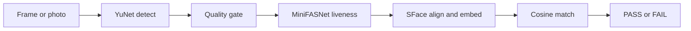

# face-attendance-spike

[](pyproject.toml)
[](https://opencv.org)
[](https://onnxruntime.ai)
[](#privacy-and-data)
[](#roadmap)

A time-boxed spike that tests on-device face recognition for a tablet time-attendance app: detect, liveness, embed, and match, all on the local machine.

Demo: no screenshot or GIF on purpose. Every useful capture of this app shows a real face, and this repo never stores biometric data.

## Table of Contents

- [Features](#features)
- [Why this stack](#why-this-stack)
- [Installation](#installation)
- [Quick Start](#quick-start)
- [CLI Reference](#cli-reference)
- [Web Demo](#web-demo)
- [Privacy and Data](#privacy-and-data)
- [Architecture](#architecture)
- [Testing](#testing)
- [Roadmap](#roadmap)
- [Contributing](#contributing)
- [License](#license)

## Features

- Stack 1 pipeline: YuNet detection, MiniFASNet passive liveness, SFace 128-d embedding, cosine match.
- 1:1 verify (pick a name) and 1:N identify ("just look at the camera") with a top-1 margin rule.
- Quality gate that rejects blurry, dark, and overexposed faces, with a logged reason.
- Local web demo: a kiosk that checks in automatically, and an admin page for enroll, thresholds, photo recognition, and the event log.
- Upload enroll saves photos in the benchmark layout `data/<set>/<person_id>/<condition>_<n>.jpg`.
- Reproducible models: pinned commits and sha256 in `models/models.lock.json`.
- Runs offline. The only network step is the one-time model download.

<p align="right">(<a href="#face-attendance-spike">back to top</a>)</p>

## Why this stack

| Option | Biometrics stay local | Commercial license | Used here |
|---|---|---|---|
| YuNet + MiniFASNet + SFace | Yes | MIT / Apache-2.0 weights | Yes (Stack 1) |
| dlib ResNet (5-point) | Yes | CC0 weights | Planned (Stack 2) |
| InsightFace model packs | Yes | Non-commercial weights | No |
| Cloud face APIs | No | Paid | No |

The weight licenses are permissive. The SFace training data is not documented. Read [LICENSE_AUDIT.md](LICENSE_AUDIT.md) before any commercial use.

<p align="right">(<a href="#face-attendance-spike">back to top</a>)</p>

## Installation

Prerequisites:

- macOS or Linux, Python 3.11.
- [uv](https://docs.astral.sh/uv/) (`brew install uv` or the official installer).
- A webcam for live tests. Upload tests work without one.

<p align="right">(<a href="#face-attendance-spike">back to top</a>)</p>

## Quick Start

```bash
git clone https://github.com/HiepPP/face-attendance-spike.git && cd face-attendance-spike
uv sync --all-groups
uv run python tools/fetch_models.py
uv run python -I tools/convert_minifasnet.py upstream/Silent-Face-Anti-Spoofing/src/model_lib/MiniFASNet.py models
uv run python demo/web.py
```

Open http://127.0.0.1:8765 and allow camera access.

- `fetch_models.py` downloads the weights and checks each sha256 against the lock file.
- `convert_minifasnet.py` converts the two MiniFASNet `.pth` files to ONNX (it needs `torch` from the dev groups) and records the output sha256 in the lock file. A different torch version can produce different ONNX bytes.

<p align="right">(<a href="#face-attendance-spike">back to top</a>)</p>

## CLI Reference

`demo/web.py` (local web demo):

| Flag | Default | Description |
|---|---|---|
| `--port` | `8765` | Port on 127.0.0.1 |
| `--data-dir` | `data/demo` | Folder for uploaded enroll photos |
| `--reset` | off | Delete the embedding gallery at start (photos stay) |

`demo/app.py` (OpenCV window demo, keys `e` `m` `Tab` `Space` `l` `q`):

| Flag | Default | Description |
|---|---|---|
| `--camera` | `0` | Camera index |
| `--reset` | off | Delete the embedding gallery at start |

`bench/pipeline_stack1.py IMAGE [IMAGE2]` prints the pipeline result for one image, or the cosine similarity for two.

<p align="right">(<a href="#face-attendance-spike">back to top</a>)</p>

## Web Demo

The page has two tabs. It uses system fonts only, so it works offline.

Kiosk:

- The camera fills the screen. A ring in the center shows where to put the face. The sharp area is the 3:4 frame that the server checks.
- Check-in is automatic and 1:N only. When the same employee is recognized in two frames in a row, the kiosk sends a check-in.
- One employee is checked in once per 60 s. The server enforces this for all kiosks that use it: a second check-in within 60 s is not logged, and the kiosk shows when to try again. The browser also keeps these times in `localStorage`, so it does not send the request again after a reload. A failed attempt blocks the same employee for 5 s.
- An unknown face, a spoof, or a bad photo shows a hint on screen and is not logged.
- The ring color shows the state: green means recognized, yellow means unknown or ambiguous, red means rejected.

Admin:

- Enroll with the webcam: 5 frames, at least 3 must pass. Only the averaged embedding is kept.
- Enroll by upload: JPEG, PNG, or WebP (no HEIC). Pick a condition such as `normal` or `mask`. The template uses the `normal` photos when there are any.
- Thresholds have a slider and a number field. Defaults: liveness 0.5, 1:1 cosine 0.363, 1:N T_strict 0.45, margin 0.05. They are not tuned yet.
- Recognize an uploaded photo in 1:N or 1:1 mode. The page shows the top-5 matches. The photo is not saved.
- The log shows the last 50 events, with a PASS/FAIL filter and a similarity bar against the current threshold.
- Click a log row to see the event detail: face crop and step timings. Photo recognition events also show the top-3 candidates. The detail exists only for events from the current browser session, in memory.

<p align="right">(<a href="#face-attendance-spike">back to top</a>)</p>

## Privacy and Data

- The server listens on 127.0.0.1 only. The code makes no outbound calls. The full test suite passes with outbound network blocked.
- `data/` (photos), `artifacts/` (embeddings, event log), `models/` weights, and `upstream/` are gitignored.
- The pre-commit hook in `.githooks/` rejects staged images or `.npy` files under `data/` or `artifacts/embeddings/`, and any weight file under `models/`. Turn it on with `git config core.hooksPath .githooks`.
- Use photos of colleagues only after they sign a consent form.

<p align="right">(<a href="#face-attendance-spike">back to top</a>)</p>

## Architecture



| Path | Role |
|---|---|
| `bench/common.py` | Result type, quality gate, liveness |
| `bench/pipeline_stack1.py` | Stack 1 pipeline |
| `demo/web.py` | Local HTTP server and API |
| `demo/static/index.html` | Web UI |
| `demo/photo_store.py` | Photo folder and employee names |
| `demo/app.py` | OpenCV window demo, gallery |
| `tools/` | Model download and ONNX conversion |
| `models/models.lock.json` | URLs, licenses, sha256 |

Known deviations from the spike plan are listed in [EXPLORE.md](EXPLORE.md).

<p align="right">(<a href="#face-attendance-spike">back to top</a>)</p>

## Testing

```bash
uv run pytest tests
```

The tests use only the 3 public sample images from Silent-Face-Anti-Spoofing (downloaded by `fetch_models.py`). They cover liveness parity with upstream PyTorch, the face-count rule, upload enroll, persistence, recognition, and the live label.

<p align="right">(<a href="#face-attendance-spike">back to top</a>)</p>

## Roadmap

- [x] T0 model setup and license audit
- [x] T1 Stack 1 pipeline
- [ ] T1 Stack 2 pipeline (dlib directly, not the `face_recognition` wrapper)
- [ ] T2 accuracy benchmark (1:1 and 1:N)
- [ ] T3 liveness benchmark (prints, screens, replays)
- [ ] T4 latency on Mac and the target tablet
- [ ] T5 Android POC
- [ ] T6 report

<p align="right">(<a href="#face-attendance-spike">back to top</a>)</p>

## Contributing

This is an internal spike. Issues and pull requests are welcome.

1. Run `git config core.hooksPath .githooks` before your first commit.
2. Add only components with an allowlisted license (MIT, Apache-2.0, BSD, BSL-1.0, CC0) and record them in [THIRD_PARTY_NOTICES.md](THIRD_PARTY_NOTICES.md).
3. Run `uv run pytest tests` before you open a pull request.

<p align="right">(<a href="#face-attendance-spike">back to top</a>)</p>

## License

No license is chosen yet, so all rights are reserved by default. Third-party components keep their own licenses: see [THIRD_PARTY_NOTICES.md](THIRD_PARTY_NOTICES.md) and [LICENSE_AUDIT.md](LICENSE_AUDIT.md).

<p align="right">(<a href="#face-attendance-spike">back to top</a>)</p>
